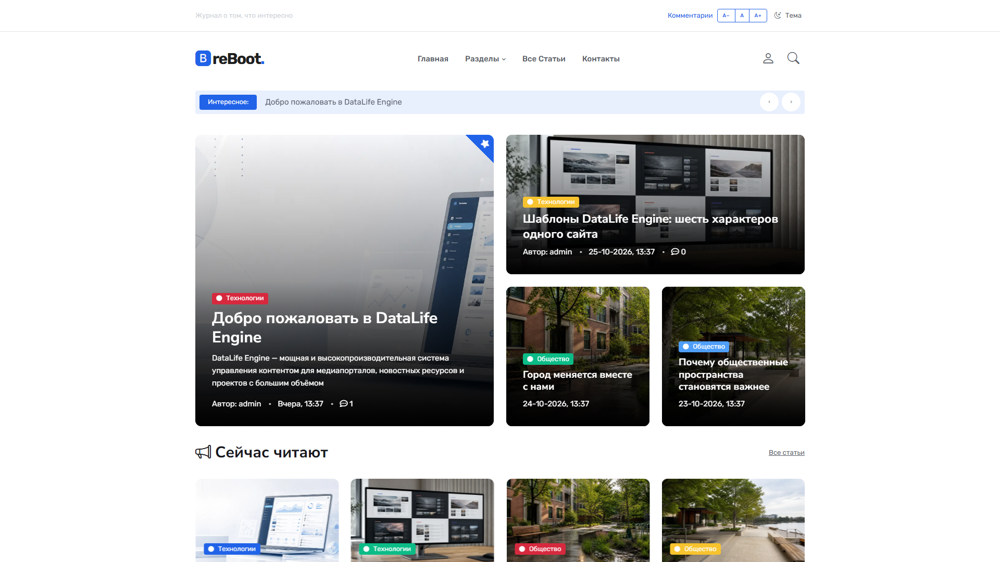
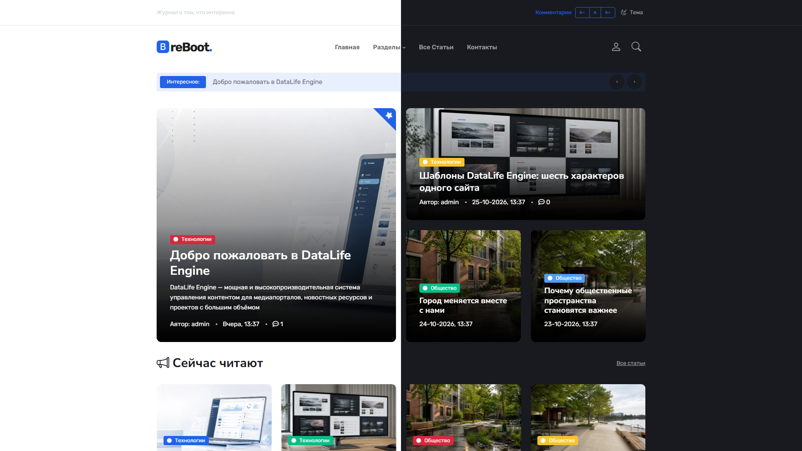
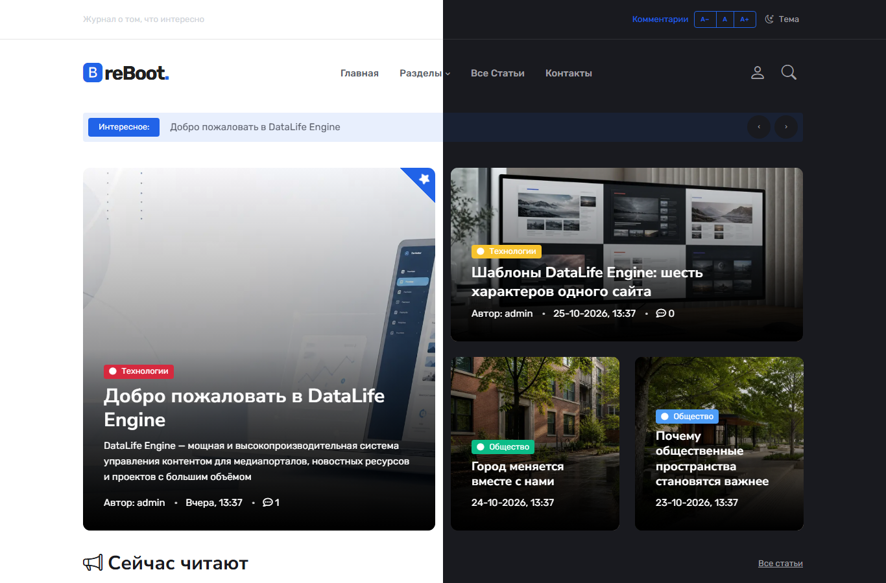
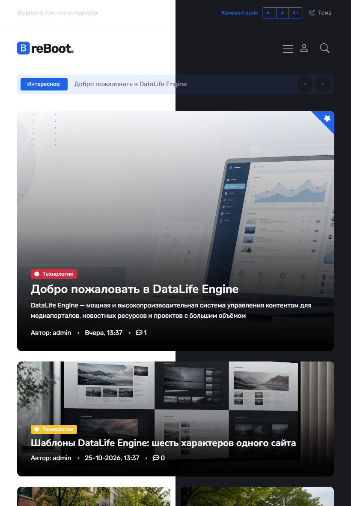
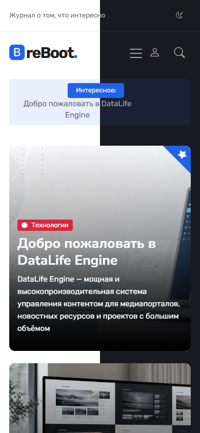
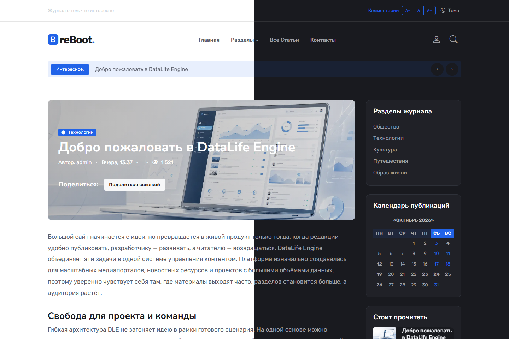

**reBoot для DLE 21**

Адаптивный шаблон для новостного сайта или онлайн-журнала на DataLife Engine 21.0. Светлая и тёмная темы, блок главных публикаций, карусель статей, боковая колонка и загрузка следующих новостей без перезагрузки страницы.

**Возможности**

- Адаптивная вёрстка для компьютеров, ноутбуков, планшетов и телефонов.
- Светлая и тёмная темы с сохранением выбора в браузере.
- Изменение размера текста в верхней панели на широком экране.
- Поиск, регистрация, профиль, комментарии, закладки, личные сообщения и обратная связь средствами DLE.
- Постраничная навигация и «Загрузить ещё» с обработкой ошибок сети.
- Bootstrap JavaScript 5.3.8 и tiny-slider 2.9.4.
- Работа без изменений ядра и дополнительных PHP-модулей.

**Установка и совместимость**

Скопируйте `reBoot` в каталог `templates` установленного DLE 21, выберите шаблон в настройках и очистите кеш. Полная инструкция — [INSTALL.md](INSTALL.md).

Проверено на DLE 21.0, PHP 8.3.30, MySQL 8.4.3, Apache 2.4.66 и Chromium. Работа с другими версиями DLE не заявляется. Для обложек используется дополнительное поле `poster` типа «Изображение», а при его отсутствии — первое изображение краткой новости. Демонстрационные статьи и база данных в архив не включены.

JavaScript, иконки и основные стили локальные. Текстовые шрифты загружаются с Google Fonts с системными заменами при недоступной сети. Отправка писем требует настроенного почтового транспорта DLE.

**Скриншоты**

Шесть экранных кадров до добавления рекламы: один в светлой теме и пять сравнений 50/50. В совмещённых кадрах слева светлая тема, справа тёмная; исходные размеры и пропорции сохранены.

Главная в светлой теме, 1920×1080:

Компьютер, 1920×1080:

Ноутбук, 1366×900:

Планшет, 820×1180:

Телефон, 390×844:

Статья, 1440×960:

**Услуги по доработке DLE**

Адаптация шаблонов, исправление ошибок и доработка сайтов на DLE.

- [Подробнее об услугах](https://the88788.com/prices/sites/dle/)
- [The88788.com](https://the88788.com/)
- [Telegram: The88788](https://t.me/The88788)

**VPS-хостинг**

[HIP.Hosting — посмотреть предложения VPS-хостинга](https://hip.hosting/?code=1b890e361ec6ae343e57). Партнёрская ссылка. Условия размещения уточняйте на сайте провайдера.

В скачиваемом шаблоне предусмотрены отдельные блоки услуг и VPS-хостинга перед футером, а также ссылка автора адаптации в футере. Файлы блоков — `reBoot/modules/partners.tpl` и `reBoot/modules/footer.tpl`.

В комплект также входят интернет-ярлыки `The88788.url` и `HIP-Hosting.url`. Ссылка автора адаптации и Telegram указаны в `INSTALL.md`.
